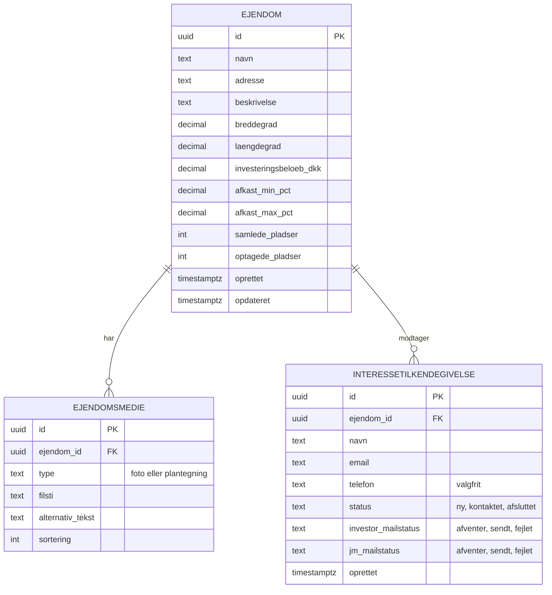

# ER-diagram for PropertyScout

Eksamensversionen har ingen brugerlogin. Modellen omfatter ejendomme, medier og interessetilkendegivelser. Dette er dokumentation; databasen er endnu ikke implementeret.

## Relationer og regler

- Én ejendom kan have nul eller flere medier og interessetilkendegivelser.
- Hvert medie og hver interessetilkendegivelse tilhører præcis én ejendom via `ejendom_id`.
- Navn og e-mail er obligatoriske ved interesse. Telefonnummer er valgfrit og gemmes som tekst, så eksempelvis `+45` kan bevares.
- Ledige pladser beregnes som `samlede_pladser - optagede_pladser`. Optagede pladser skal være mellem nul og det samlede antal.
- JM godkender investorer uden for appen og opdaterer optagede pladser manuelt. En interessetilkendegivelse reserverer ikke en plads.
- Afkast er et estimat og ikke garanteret. Minimumsafkast må ikke overstige maksimumsafkast.
- Billeder og plantegninger kan gemmes i Supabase Storage; `filsti` angiver deres placering.
- Modellen kræver hverken en brugertabel eller en junction-tabel.

## Kvittering og opfølgning

Interessen gemmes i Supabase. En serverfunktion sender via Resend en kvittering til investoren og en separat besked til JM. Kvitteringen angiver ejendommens navn og adresse samt, at en ejendomsinvesteringskonsulent vil kontakte investoren. Den gør tydeligt, at interessen er uforpligtende og ikke reserverer en plads.

`status` beskriver behandlingen af henvendelsen. De to mailstatusfelter beskriver afsendelsen til hver modtager og starter som `afventer`. `sendt` betyder, at mailudbyderen har accepteret afsendelsen, ikke nødvendigvis at mailen er leveret. En fejl ved mailafsendelse må ikke slette interessen. Gentagne afsendelsesforsøg skal håndteres uden at oprette interessen igen.

Kontaktoplysninger må ikke kunne læses af andre appbrugere. Resend-nøglen skal opbevares på serveren.
