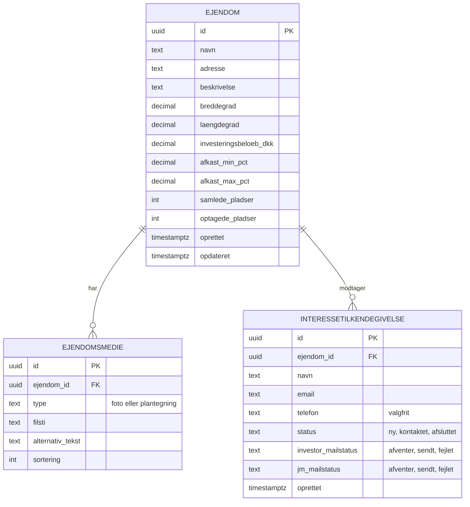

# ER-diagram for PropertyScout

Eksamensversionen har ingen brugerlogin. Modellen omfatter ejendomme, medier og interessetilkendegivelser. Dette er dokumentation; databasen er endnu ikke implementeret.

## Relationer

- En ejendom kan have nul eller flere medier. Hvert medie tilhører præcis en ejendom via `ejendom_id`.
- En ejendom kan have nul eller flere interessetilkendegivelser. Hver interessetilkendegivelse tilhører præcis en ejendom via `ejendom_id`.
- Begge relationer er en-til-mange.
